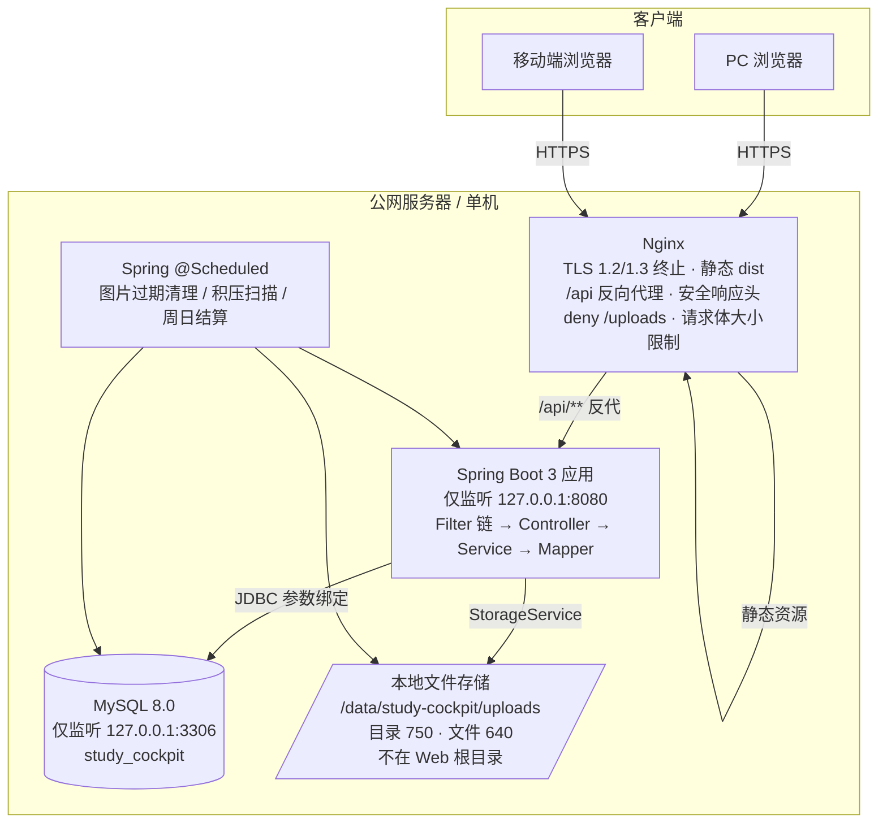

> 文档性质：早期设计草案，保留原始阶段描述以供参考；当前项目状态和运行方式见根目录 README。

# 学习监控驾驶舱平台 · 第一步交付：项目架构 / 目录结构 / 数据库设计 / 页面路由方案

> 项目代号：`study-cockpit`
> 文档版本：v1.0 · 状态：**待确认**
> 本轮范围：按用户指定的开发顺序，仅输出设计方案，**确认无误后再开始编码**。
> 需求边界：严格实现需求清单内的功能，不额外增加业务功能；为支撑既有需求而设的数据结构与基础设施会在文中显式标注理由。

---

## 0. 执行计划与阶段划分

| 阶段 | 内容 | 交付物 | 状态 |
|---|---|---|---|
| **第一步（本轮）** | 项目架构、目录结构、数据库设计（含完整 DDL）、页面路由方案、接口清单、安全落地映射 | 本文档 + `docs/sql/schema.sql` | 待确认 |
| 第二步 | 后端骨架、配置、安全基础设施、数据库实体与 Mapper | `backend/` | 待开始 |
| 第三步 | 认证、目标/科目/任务、图片、驾驶舱、周报导出、归档、提醒、定时任务 | `backend/` 全量接口 | 待开始 |
| 第四步 | 前端骨架、深色工业风主题、路由守卫、6 个页面 | `frontend/` | 待开始 |
| 第五步 | 部署文档（Nginx / HTTPS / systemd / 文件目录权限）、`.env.example`、联调冒烟验证 | `deploy/` + 部署文档 | 待开始 |

⚡ 执行策略：后端按 Controller → Service → Mapper 三层严格分层（对应用户「前后端分层清晰」），前端按 `api / views / components / stores / utils` 分层；认证采用无状态 JWT + HttpOnly Cookie + CSRF 双提交；限流与黑名单用本地 Caffeine/Bucket4j 单实例实现（不引入 Redis，贴合固定技术栈）；文件存储抽象为 `StorageService` 接口，默认本地实现并预留对象存储扩展位；全部敏感配置走环境变量并启动时 fail-fast 校验。

---

## 1. 总体架构

### 1.1 部署拓扑（单公网服务器，个人独立部署）



> 关键约束：**后端与 MySQL 均不对公网暴露**；前端构建产物与后端 API **同域**（Nginx 反代 `/api`），因此生产环境不需要开启 CORS，从源头减少跨域攻击面；图片目录被 Nginx `deny all`，任何图片字节流必须经后端鉴权接口返回。

### 1.2 请求主链路

```
浏览器
  │ HTTPS + 同源 Cookie(HttpOnly/Secure/SameSite=Strict) + X-XSRF-TOKEN
  ▼
Nginx（TLS 终止 → 安全响应头 → client_max_body_size → /api 反代 → 静态 fallback）
  ▼
Spring Boot Filter 链（顺序固定）
  ① TraceIdFilter            MDC 注入 traceId，结构化 JSON 日志
  ② RateLimitFilter          全局接口限流（IP + URI 维度）
  ③ XssFilter                全局 XSS 入参清洗 / 危险字符拒绝
  ④ SecurityFilterChain      CSRF 双提交校验 → JwtAuthenticationFilter（Cookie 解析 JWT）
                             → 鉴权（除白名单外全部需认证） → SecurityContext
  ⑤ Controller              仅做参数绑定与校验（@Valid），不含业务逻辑
  ⑥ Service                 业务逻辑 + 事务 + 强制注入 user_id 做数据隔离
  ⑦ Mapper (MyBatis-Plus)   参数化 SQL，禁止 ${} 拼接
  ▼
统一响应 Result<T> / 全局异常处理器（生产不返回堆栈）
```

### 1.3 技术栈版本清单（固定，不擅自替换）

| 层 | 组件 | 版本基线 | 说明 |
|---|---|---|---|
| 后端 | JDK | 17 LTS | Spring Boot 3 最低要求 |
| 后端 | Spring Boot | 3.2.x | Web / Validation / Security / AOP |
| 后端 | Spring Security | 6.2.x | 无状态 Session + CSRF 双提交 |
| 后端 | MyBatis-Plus | 3.5.5+ | 分页插件 / 逻辑删除 / 自动填充 / 防全表更新拦截器 |
| 后端 | MySQL 驱动 + HikariCP | 8.0.x / Boot 内置 | 连接池参数显式配置 |
| 后端 | JJWT | 0.12.x | HS256 签名，密钥 ≥ 32 字节 |
| 后端 | Caffeine + Bucket4j | — | 单实例限流、登录失败锁定、jti 黑名单、用户令牌版本缓存 |
| 后端 | Apache Commons CSV | — | 流式 CSV 生成 + 公式注入防护 |
| 后端 | Spring `@Scheduled` | Boot 内置 | 3 个定时任务，`zone = "Asia/Shanghai"` |
| 前端 | Vue | 3.4.x | Composition API + `<script setup>` |
| 前端 | TypeScript | 5.4.x | 严格模式 |
| 前端 | Vite | 5.x | `dist` 由 Nginx 托管 |
| 前端 | Element Plus | 2.7.x | 深色主题变量覆写 |
| 前端 | ECharts | 5.5.x | 仅环形图 / 折线图 / 柱状图，无多余动画 |
| 前端 | Vue Router 4 / Pinia 2 / Axios 1 | — | 路由守卫 / 状态 / 请求封装 |
| 部署 | Nginx + systemd + TLS 证书 | — | HTTPS、目录权限、环境变量隔离 |

### 1.4 关键架构决策（逐条声明）

| 决策项 | 结论 | 理由 |
|---|---|---|
| 项目结构 | **Layer-first**（controller/service/mapper/entity/dto） | 用户明确要求「前后端分层清晰」；Java + MyBatis-Plus 生态主流 |
| API 风格 | 标准 RESTful + 统一 `Result<T>` 包装 | 用户明确要求 |
| 认证策略 | **无状态 JWT + HttpOnly/Secure/SameSite=Strict Cookie + CSRF 双提交 Cookie** | 前端完全不接触 token，杜绝 XSS 窃取；`` 请求天然携带 Cookie，图片鉴权链路更短；同域反代无跨域问题 |
| 实时方案 | 不需要（无 WebSocket/SSE） | 需求无实时推送；登录后实时聚合展示预警 |
| 错误处理 | 类型化业务异常 + 全局 `@RestControllerAdvice` | 生产脱敏，不返回堆栈 |
| 配置管理 | 全部敏感项走环境变量 + 启动时 fail-fast 校验 | 对应安全要求 7 |
| 文件存储 | `StorageService` 接口 + `LocalFileStorageServiceImpl` | 预留 `OssStorageServiceImpl` 扩展位（仅留接口与配置项，不实现） |
| 健康检查 | **不启用 Actuator**；Nginx 对静态首页探活 | 对应安全要求 6「关闭监控端点」，不暴露任何环境信息 |
| 限流存储 | 本地 Caffeine + Bucket4j，不引入 Redis | 单机个人部署；固定技术栈未含 Redis，避免额外组件 |
| 删除语义 | 业务数据逻辑删除；图片记录按需求物理删除 | 保证历史归档与周结算数据不被破坏；需求明确要求「清除数据库内对应的图片记录」 |

---

## 2. 项目目录结构

```
study-cockpit/
├── docs/
│   ├── 01-架构设计与数据库设计.md        # 本文档（第一步交付）
│   ├── 02-部署文档.md                    # 第五步交付：Nginx/HTTPS/权限/systemd
│   ├── 03-接口文档.md                    # 第三步交付：完整出入参与错误码
│   └── sql/
│       └── schema.sql                    # 完整 MySQL 建表语句（V1 初始化脚本，可直接执行）
├── backend/
│   ├── pom.xml
│   └── src/main/
│       ├── java/com/study/cockpit/
│       │   ├── CockpitApplication.java
│       │   ├── common/                  # 统一响应、错误码、异常体系
│       │   │   ├── Result.java  ResultCode.java  PageResult.java
│       │   │   ├── BusinessException.java  ErrorCode.java
│       │   │   └── GlobalExceptionHandler.java
│       │   ├── config/
│       │   │   ├── SecurityConfig.java        # SecurityFilterChain / CSRF / 白名单
│       │   │   ├── MybatisPlusConfig.java     # 分页/逻辑删除/防全表更新拦截器
│       │   │   ├── JacksonConfig.java         # UTC+8 + 全局 String 反序列化转义
│       │   │   ├── WebMvcConfig.java          # 静态资源映射关闭、拦截器注册
│       │   │   ├── CorsConfig.java            # 生产默认关闭
│       │   │   ├── SchedulingConfig.java      # @EnableScheduling + 统一时区
│       │   │   ├── StorageProperties.java     # @ConfigurationProperties + 启动校验
│       │   │   └── SecurityProperties.java   # JWT/限流/上传参数集中配置
│       │   ├── security/
│       │   │   ├── JwtTokenProvider.java     # 签发/验签/jti/ver/短有效期
│       │   │   ├── JwtAuthenticationFilter.java  # 从 HttpOnly Cookie 解析
│       │   │   ├── JwtBlacklistService.java  # jti 黑名单（Caffeine）
│       │   │   ├── LoginAttemptService.java  # 登录防爆破（失败锁定）
│       │   │   ├── RateLimitFilter.java      # 全局限流（Bucket4j + Caffeine）
│       │   │   ├── XssFilter.java / XssRequestWrapper.java
│       │   │   ├── ImageUrlSigner.java      # 图片临时地址 HMAC 签名与校验
│       │   │   ├── SecurityHeadersFilter.java
│       │   │   ├── TraceIdFilter.java
│       │   │   └── SecurityUtils.java       # 统一获取当前 userId
│       │   ├── controller/                # 9 个：Auth/Goal/Subject/Task/TaskImage/
│       │   │                              #      Dashboard/Report/Archive/Notification
│       │   ├── service/                    # 接口 + impl（事务与业务逻辑）
│       │   │   └── storage/
│       │   │       ├── StorageService.java              # 扩展点
│       │   │       └── LocalFileStorageServiceImpl.java # 默认本地实现
│       │   ├── mapper/                     # MyBatis-Plus BaseMapper + 自定义聚合 SQL
│       │   ├── entity/                     # 6 张表对应实体
│       │   ├── dto/                        # request/response/vo，边界校验全部在此
│       │   ├── enums/                      # 完成状态、图片格式、错误码枚举
│       │   ├── validation/                 # @Valid 自定义注解（掌握度/权重/日期）
│       │   ├── task/
│       │   │   ├── ImageExpireCleanTask.java   # 15 天到期清理
│       │   │   ├── OverdueScanTask.java        # 未完成任务扫描
│       │   │   └── WeeklySettlementTask.java   # 周日结算快照
│       │   ├── notify/
│       │   │   ├── NotificationSender.java     # 邮件扩展接口（仅预留）
│       │   │   └── InAppNotificationSender.java
│       │   └── util/
│       │       ├── WeekUtils.java          # UTC+8 周起始/结算
│       │       ├── CompletionCalculator.java # 加权完成度算法
│       │       ├── FileTypeDetector.java   # 魔数 + 后缀双重校验
│       │       └── CsvUtils.java           # 流式导出 + CSV 公式注入防护
│       └── resources/
│           ├── application.yml            # 仅通用配置，全部敏感项 ${ENV}
│           ├── application-dev.yml
│           ├── application-prod.yml
│           ├── logback-spring.xml         # 结构化 JSON 日志，脱敏
│           └── mapper/*.xml               # 仅聚合查询，参数化
├── frontend/
│   ├── .env.example                       # VITE_API_BASE_URL=/api（不含密钥）
│   ├── vite.config.ts                     # dev proxy → 127.0.0.1:8080
│   ├── tsconfig.json / index.html / package.json
│   └── src/
│       ├── main.ts  App.vue
│       ├── api/            # auth.ts goal.ts task.ts image.ts dashboard.ts report.ts archive.ts
│       ├── router/index.ts # 路由表 + requiresAuth 守卫
│       ├── stores/         # user.ts（仅存用户展示信息，不存 token）
│       ├── layout/         # Sidebar / Header / AppMain（移动端抽屉）
│       ├── components/     # EChartWrap / ProgressCard / StatCard / ImageUploader / BacklogPanel
│       ├── composables/    # useChartResize.ts / useWeek.ts
│       ├── styles/         # dark-industrial 主题变量、响应式断点
│       ├── types/          # 与后端 DTO 对齐的 TS 类型
│       ├── utils/          # request.ts(Axios + CSRF + 错误映射) / date.ts(UTC+8)
│       └── views/
│           ├── login/LoginView.vue
│           ├── dashboard/DashboardView.vue
│           ├── goals/GoalSubjectView.vue
│           ├── tasks/TaskView.vue
│           ├── weekly/WeeklyAnalysisView.vue
│           └── archive/ArchiveView.vue
└── deploy/
    ├── nginx/study-cockpit.conf          # HTTPS / 反代 / 安全头 / deny uploads
    ├── systemd/study-cockpit.service     # EnvironmentFile 注入环境变量
    ├── env.example                       # 环境变量模板（无真实密钥）
    └── scripts/init-db.sh / init-user.sh # 建库、生成 BCrypt 密文初始化账号
```

---

## 3. 数据库设计

### 3.1 设计原则

1. **数据隔离**：除 `sys_user` 外，所有业务表均带 `user_id`，且所有查询/更新/删除强制带 `user_id = 当前登录用户`；跨用户访问统一返回 **404**（不泄露资源是否存在）。
2. **时区统一**：全部时间列使用 `DATETIME`（不做隐式时区转换）存储 **UTC+8 墙上时间**；`DATE` 存任务归属日与周起止日。不使用 `TIMESTAMP`，避免 MySQL 会话时区导致周次错乱。
3. **逻辑删除**：`study_goal / study_subject / daily_task` 使用 `deleted TINYINT`，MyBatis-Plus `@TableLogic` 自动追加条件；**所有自定义聚合 SQL 必须显式写 `deleted = 0`**（拦截器不作用于手写 SQL，此为强制编码约束）。
4. **图片记录物理删除**：`task_image` 按需求在到期时删除记录与物理文件；为保证「清除数据库内对应的图片记录」可重试，清理任务采用「分页扫描 → 删文件 → 删记录」并保证最终一致。
5. **索引**：所有外键列、`user_id + 日期` 组合、`expire_time`、幂等唯一键均建索引；不建物理外键（由应用层事务保证引用完整性，便于逻辑删除与归档）。
6. **约束下推**：完成度聚合、过期扫描、周结算等统计一律在 SQL 层用索引 + `WHERE` 过滤完成，禁止全表捞回应用层过滤。

### 3.2 表关系

```
sys_user (1) ──< (N) study_goal ──< (N) study_subject ──< (N) daily_task ──< (N) task_image
     │                                                          │
     └──────────────< (N) weekly_summary（周日结算快照，goal_id=0 表示全部目标汇总）
```
`daily_task` 冗余 `goal_id`：让「按目标筛选/导出/归档」无需 JOIN 科目表，直接用联合索引覆盖。

### 3.3 表清单

| # | 表名 | 用途 | 删除策略 | 对应需求 |
|---|---|---|---|---|
| 1 | `sys_user` | 登录账号、BCrypt 密文、令牌版本 | 不删除（可禁用） | 安全 1/2 |
| 2 | `study_goal` | 备考大目标（考研 / 教师编 / 自定义） | 逻辑删除 | 功能 1 |
| 3 | `study_subject` | 目标下科目 + 默认权重 | 逻辑删除 | 功能 1 |
| 4 | `daily_task` | 每日任务、权重、截止时间、掌握度、复盘、完成状态 | 逻辑删除 | 功能 2/5/6/7 |
| 5 | `task_image` | 图片存储记录 + 15 天过期时间 | **物理删除** | 功能 3（新增） |
| 6 | `weekly_summary` | 周日结算快照 | 不删除（幂等覆盖） | 功能 4/5/6 + 归档 |

> `weekly_summary` 是为支撑「**周日结算**」「**历史数据归档页**」「**学习基线对比**」三个既有需求而设的数据落点，**不是新增业务功能**。若确认阶段选择「不建快照表」，则改为全部实时 SQL 聚合，见 §12 决策点 D4。

### 3.4 字段设计要点

| 表 | 关键字段 | 说明 |
|---|---|---|
| `sys_user` | `password` `VARCHAR(100)` | BCrypt（strength 12）密文，永不明文 |
| `sys_user` | `token_version INT` | JWT 携带 `ver`，改密/强制下线时 `+1`，旧令牌立即失效 |
| `study_subject` | `default_weight DECIMAL(5,2)` | 创建任务时作为权重默认值带入，用户可覆盖 |
| `daily_task` | `task_date DATE` | 归属日，用于日/周聚合；与 `deadline`（截止时刻）语义分离 |
| `daily_task` | `mastery TINYINT` | 1–5 掌握度，`CHECK` 约束 |
| `daily_task` | `finish_status / finished_at` | 完成标记与完成时间，驱动完成度与打卡 |
| `task_image` | `stored_name` / `relative_path` | UUID 重命名 + 后端生成相对路径（如 `2026/11/<uuid>.jpg`），**不接受任何用户输入路径** |
| `task_image` | `magic_verified` | 文件头魔数校验通过标记，双重校验留痕 |
| `task_image` | `upload_time` / `expire_time` | `expire_time = upload_time + 15 天`，清理任务扫描列 |
| `weekly_summary` | `goal_id = 0` 哨兵值 | 表示「全部目标汇总」，避免 NULL 破坏唯一索引幂等性 |
| `weekly_summary` | `uk_user_goal_week` | 结算任务用 `INSERT ... ON DUPLICATE KEY UPDATE` 保证可重复执行 |

### 3.5 完整 MySQL 建表语句

> 同时输出为可执行脚本：`docs/sql/schema.sql`（内容一致）。目标版本 MySQL 8.0.16+（依赖 CHECK 约束生效）。

```sql
-- ============================================================
-- 学习监控驾驶舱平台 · MySQL 8.0 初始化建表脚本
-- 时区约定：所有 DATETIME/DATE 均为 UTC+8 (Asia/Shanghai) 墙上时间
-- ============================================================
CREATE DATABASE IF NOT EXISTS study_cockpit
  DEFAULT CHARACTER SET utf8mb4
  DEFAULT COLLATE utf8mb4_0900_ai_ci;
USE study_cockpit;

-- 1. 系统用户表 -------------------------------------------------
CREATE TABLE sys_user (
  id            BIGINT UNSIGNED NOT NULL AUTO_INCREMENT COMMENT '主键',
  username      VARCHAR(64)  NOT NULL                COMMENT '登录用户名',
  password      VARCHAR(100) NOT NULL                COMMENT 'BCrypt 加盐密文',
  nickname      VARCHAR(64)  DEFAULT NULL            COMMENT '昵称(展示用)',
  status        TINYINT      NOT NULL DEFAULT 1      COMMENT '1正常 0禁用',
  token_version INT          NOT NULL DEFAULT 0      COMMENT '令牌版本, 改密后+1使旧JWT全部失效',
  created_at    DATETIME     NOT NULL DEFAULT CURRENT_TIMESTAMP,
  updated_at    DATETIME     NOT NULL DEFAULT CURRENT_TIMESTAMP ON UPDATE CURRENT_TIMESTAMP,
  PRIMARY KEY (id),
  UNIQUE KEY uk_username (username),
  CONSTRAINT ck_user_status CHECK (status IN (0, 1))
) ENGINE=InnoDB DEFAULT CHARSET=utf8mb4 COLLATE=utf8mb4_0900_ai_ci COMMENT='系统用户表';

-- 2. 备考目标表 -------------------------------------------------
CREATE TABLE study_goal (
  id         BIGINT UNSIGNED NOT NULL AUTO_INCREMENT COMMENT '主键',
  user_id    BIGINT UNSIGNED NOT NULL                COMMENT '所属用户(数据隔离)',
  name       VARCHAR(128) NOT NULL                   COMMENT '目标名称, 如 2027考研/教师编/自定义',
  deleted    TINYINT      NOT NULL DEFAULT 0        COMMENT '0正常 1已删除(逻辑)',
  created_at DATETIME     NOT NULL DEFAULT CURRENT_TIMESTAMP,
  updated_at DATETIME     NOT NULL DEFAULT CURRENT_TIMESTAMP ON UPDATE CURRENT_TIMESTAMP,
  PRIMARY KEY (id),
  KEY idx_user_del (user_id, deleted),
  KEY idx_user_id  (user_id, id),
  CONSTRAINT ck_goal_deleted CHECK (deleted IN (0, 1))
) ENGINE=InnoDB DEFAULT CHARSET=utf8mb4 COLLATE=utf8mb4_0900_ai_ci COMMENT='备考目标表';

-- 3. 科目表 -----------------------------------------------------
CREATE TABLE study_subject (
  id             BIGINT UNSIGNED NOT NULL AUTO_INCREMENT COMMENT '主键',
  user_id        BIGINT UNSIGNED NOT NULL                COMMENT '所属用户(冗余, 便于隔离过滤)',
  goal_id        BIGINT UNSIGNED NOT NULL                COMMENT '所属备考目标',
  name           VARCHAR(128) NOT NULL                   COMMENT '科目名称',
  default_weight DECIMAL(5,2) NOT NULL DEFAULT 1.00     COMMENT '默认权重, 创建任务时带入',
  deleted        TINYINT      NOT NULL DEFAULT 0        COMMENT '0正常 1已删除(逻辑)',
  created_at     DATETIME     NOT NULL DEFAULT CURRENT_TIMESTAMP,
  updated_at     DATETIME     NOT NULL DEFAULT CURRENT_TIMESTAMP ON UPDATE CURRENT_TIMESTAMP,
  PRIMARY KEY (id),
  KEY idx_user_goal_del (user_id, goal_id, deleted),
  KEY idx_goal_id       (goal_id, id),
  CONSTRAINT ck_subject_weight CHECK (default_weight > 0),
  CONSTRAINT ck_subject_deleted CHECK (deleted IN (0, 1))
) ENGINE=InnoDB DEFAULT CHARSET=utf8mb4 COLLATE=utf8mb4_0900_ai_ci COMMENT='科目表';

-- 4. 每日任务表 -------------------------------------------------
CREATE TABLE daily_task (
  id            BIGINT UNSIGNED NOT NULL AUTO_INCREMENT COMMENT '主键',
  user_id       BIGINT UNSIGNED NOT NULL                COMMENT '所属用户(数据隔离)',
  goal_id       BIGINT UNSIGNED NOT NULL                COMMENT '冗余目标ID, 便于按目标聚合/导出',
  subject_id    BIGINT UNSIGNED NOT NULL                COMMENT '所属科目',
  title         VARCHAR(255) NOT NULL                   COMMENT '任务内容',
  weight        DECIMAL(5,2) NOT NULL DEFAULT 1.00      COMMENT '任务权重(默认取科目默认权重)',
  task_date     DATE         NOT NULL                   COMMENT '任务归属日(UTC+8), 用于日/周聚合',
  deadline      DATETIME     DEFAULT NULL               COMMENT '截止时间(UTC+8)',
  mastery       TINYINT      DEFAULT NULL               COMMENT '掌握度 1-5',
  review_note   VARCHAR(1000) DEFAULT NULL              COMMENT '复盘备注',
  finish_status TINYINT      NOT NULL DEFAULT 0         COMMENT '0未完成 1已完成',
  finished_at   DATETIME     DEFAULT NULL               COMMENT '完成时间(UTC+8)',
  deleted       TINYINT      NOT NULL DEFAULT 0         COMMENT '0正常 1已删除(逻辑)',
  created_at    DATETIME     NOT NULL DEFAULT CURRENT_TIMESTAMP,
  updated_at    DATETIME     NOT NULL DEFAULT CURRENT_TIMESTAMP ON UPDATE CURRENT_TIMESTAMP,
  PRIMARY KEY (id),
  KEY idx_user_date_del      (user_id, task_date, deleted),                    -- 当日/本周趋势聚合
  KEY idx_user_goal_date_del (user_id, goal_id, task_date, deleted),          -- 按目标周导出/归档
  KEY idx_user_subject_date  (user_id, subject_id, task_date, deleted),       -- 科目完成度
  KEY idx_backlog            (user_id, finish_status, deleted, task_date, deadline), -- 积压/逾期扫描
  KEY idx_subject_id         (subject_id),
  CONSTRAINT ck_task_mastery       CHECK (mastery BETWEEN 1 AND 5),
  CONSTRAINT ck_task_weight        CHECK (weight > 0),
  CONSTRAINT ck_task_finish_status CHECK (finish_status IN (0, 1)),
  CONSTRAINT ck_task_deleted       CHECK (deleted IN (0, 1))
) ENGINE=InnoDB DEFAULT CHARSET=utf8mb4 COLLATE=utf8mb4_0900_ai_ci COMMENT='每日任务表';

-- 5. 图片存储记录表（新增）---------------------------------------
CREATE TABLE task_image (
  id             BIGINT UNSIGNED NOT NULL AUTO_INCREMENT COMMENT '主键',
  user_id        BIGINT UNSIGNED NOT NULL                COMMENT '归属用户(图片访问鉴权)',
  task_id        BIGINT UNSIGNED NOT NULL                COMMENT '绑定任务',
  original_name  VARCHAR(255) NOT NULL                   COMMENT '原始文件名, 仅展示, 绝不用于落盘路径',
  stored_name    VARCHAR(128) NOT NULL                   COMMENT 'UUID 重命名后的文件名',
  relative_path  VARCHAR(512) NOT NULL                   COMMENT '相对存储根路径, 如 2026/11/<uuid>.jpg',
  ext            VARCHAR(10)  NOT NULL                   COMMENT '规范化后缀: jpg/png/webp',
  mime_type      VARCHAR(64)  NOT NULL                   COMMENT '文件头探测出的真实 MIME',
  file_size      BIGINT UNSIGNED NOT NULL                COMMENT '文件字节数',
  magic_verified TINYINT      NOT NULL DEFAULT 1        COMMENT '文件头魔数校验通过标记',
  upload_time    DATETIME     NOT NULL                   COMMENT '上传时间(UTC+8), 15 天计时起点',
  expire_time    DATETIME     NOT NULL                   COMMENT '过期时间 = upload_time + INTERVAL 15 DAY',
  created_at     DATETIME     NOT NULL DEFAULT CURRENT_TIMESTAMP,
  PRIMARY KEY (id),
  KEY idx_user_task (user_id, task_id),   -- 列表查询 + 归属校验
  KEY idx_expire    (expire_time),        -- 过期清理任务扫描(核心索引)
  KEY idx_task_id   (task_id),            -- CSV 导出统计图片数量
  KEY idx_user_id   (user_id),
  CONSTRAINT ck_image_size   CHECK (file_size > 0),
  CONSTRAINT ck_image_expire CHECK (expire_time > upload_time)
) ENGINE=InnoDB DEFAULT CHARSET=utf8mb4 COLLATE=utf8mb4_0900_ai_ci COMMENT='任务图片存储记录表(15天有效)';

-- 6. 周结算快照表 -----------------------------------------------
CREATE TABLE weekly_summary (
  id              BIGINT UNSIGNED NOT NULL AUTO_INCREMENT COMMENT '主键',
  user_id         BIGINT UNSIGNED NOT NULL                COMMENT '所属用户',
  goal_id         BIGINT UNSIGNED NOT NULL DEFAULT 0      COMMENT '目标ID; 0=全部目标汇总(哨兵值, 避免NULL破坏唯一键)',
  week_start      DATE         NOT NULL                   COMMENT '周一(UTC+8)',
  week_end        DATE         NOT NULL                   COMMENT '周日(UTC+8)',
  task_total      INT          NOT NULL DEFAULT 0        COMMENT '任务总数',
  task_finished   INT          NOT NULL DEFAULT 0        COMMENT '已完成任务数',
  weight_total    DECIMAL(10,2) NOT NULL DEFAULT 0.00    COMMENT '总权重',
  weight_finished DECIMAL(10,2) NOT NULL DEFAULT 0.00    COMMENT '已完成权重',
  completion_rate DECIMAL(5,2) NOT NULL DEFAULT 0.00     COMMENT '加权完成率(%)',
  avg_daily_rate  DECIMAL(5,2) NOT NULL DEFAULT 0.00     COMMENT '本周平均每日完成率(%)',
  checkin_days    INT          NOT NULL DEFAULT 0        COMMENT '本周打卡天数',
  snapshot_at     DATETIME     NOT NULL DEFAULT CURRENT_TIMESTAMP ON UPDATE CURRENT_TIMESTAMP,
  PRIMARY KEY (id),
  UNIQUE KEY uk_user_goal_week (user_id, goal_id, week_start),  -- 结算幂等
  KEY idx_user_week (user_id, week_start),                       -- 历史归档列表/基线对比
  CONSTRAINT ck_week_rate CHECK (completion_rate BETWEEN 0 AND 100)
) ENGINE=InnoDB DEFAULT CHARSET=utf8mb4 COLLATE=utf8mb4_0900_ai_ci COMMENT='周结算快照表(支撑周日结算/归档/基线)';
```

### 3.6 索引与查询映射

| 查询场景 | 命中索引 | 说明 |
|---|---|---|
| 当日 / 本周任务与完成率 | `idx_user_date_del` | `WHERE user_id=? AND task_date BETWEEN ? AND ? AND deleted=0` |
| 按目标周导出 / 归档 | `idx_user_goal_date_del` | 过滤下推到 SQL，避免全表捞回 |
| 科目完成度 | `idx_user_subject_date` | 按科目聚合 |
| 积压 / 逾期扫描 | `idx_backlog` | `finish_status=0 AND deleted=0 AND (task_date < CURDATE() OR deadline < NOW())` |
| 图片过期清理 | `idx_expire` | `WHERE expire_time <= NOW() LIMIT 500` 分页循环 |
| 图片列表 / 归属鉴权 | `idx_user_task` | 强制 `user_id` + `task_id` 双条件 |
| 周结算幂等写入 | `uk_user_goal_week` | `ON DUPLICATE KEY UPDATE` |
| 历史归档 / 基线对比 | `idx_user_week` | 按周倒序分页 |

---

## 4. 核心算法与业务规则（编码前统一口径，消除歧义）

### 4.1 完成度算法（加权）

设某范围内任务集合 `T`，单任务权重 `w_i > 0`，`finished_i ∈ {0,1}`：

```
总权重     W_total     = Σ w_i
已完成权重 W_finished  = Σ (w_i × finished_i)
完成率(%)  R           = W_total = 0 ? 0 : (W_finished / W_total) × 100   // 保留 2 位小数
```

| 指标 | 任务集合范围 |
|---|---|
| **科目完成度** | 指定 `subject_id` + 指定日期范围 + `user_id` + `deleted=0` |
| **目标完成度** | 指定 `goal_id` + 指定日期范围 + `user_id` + `deleted=0` |
| **当日整体完成度** | `task_date = 今日` + `user_id` + `deleted=0` |
| **本周趋势折线** | 本周一至周日共 7 个点，逐日按「当日整体完成度」计算；**未来日期返回 null**（前端断点，不画 0） |
| **本周平均完成率** | 本周内「有任务的日期」的完成率算术平均；无任务日不计入，避免被拉低 |
| **各目标进度卡片** | 目标从创建日至今日的累计加权完成率 + 本周完成率 |
| **分母为 0** | 返回 0 并在响应中带 `hasTask=false`，前端展示「暂无任务」而非 0% |

> 创建任务时：若未显式传 `weight`，取 `study_subject.default_weight`；用户显式传入则以传入值为准。

### 4.2 连续打卡天数

- 「打卡」定义：某日存在至少 1 条 `finish_status=1` 且 `deleted=0` 的任务。
- 从**今日**起向前逐日判定；若今日尚无完成任务，则从**昨日**起算（避免当天还没学习就断签）。
- 遇首个「无完成任务日」中断，返回连续天数。SQL 用 `SELECT DISTINCT task_date ... ORDER BY task_date DESC` 后在应用层顺序计数（结果集已被 `idx_user_date_del` 覆盖，数据量小）。

### 4.3 学习基线对比

- 基线 = 最近 **4 个已结算周**（`weekly_summary`，`goal_id=0`，不含本周）的 `completion_rate` 算术平均。
- 输出：基线值、本周当前完成率、差值（本周 − 基线）、相对提升百分比。
- 历史不足 4 周取已有周数；不足 1 周返回 `baseline=null` + 提示「暂无基线数据」。

### 4.4 积压任务与预警

```
积压/逾期 = finish_status = 0 AND deleted = 0 AND
            ( deadline IS NOT NULL AND deadline < NOW()
              OR task_date < CURDATE() )
```
- 前端任务列表、驾驶舱「积压任务预警面板」对命中任务**标红**，按逾期天数倒序。
- 未过期但当日未完成的任务为普通状态（不标红）。
- 登录后 `GET /api/notifications/overdue` 返回聚合数量 + Top N 明细，用于站内提醒。

### 4.5 时间规则（UTC+8 全链路统一）

| 位置 | 配置 |
|---|---|
| JVM | `-Duser.timezone=Asia/Shanghai` / 容器 `TZ=Asia/Shanghai` |
| Spring Boot | `spring.jackson.time-zone=Asia/Shanghai`、`spring.jackson.date-format=yyyy-MM-dd HH:mm:ss` |
| JDBC | `serverTimezone=Asia/Shanghai&connectionTimeZone=Asia/Shanghai` |
| MySQL | `default-time-zone='+08:00'`；使用 `DATETIME` 存墙上时间，不做隐式转换 |
| 定时任务 | 所有 `@Scheduled(cron=..., zone="Asia/Shanghai")` |
| 代码 | 一律 `LocalDate / LocalDateTime`，禁用 `java.util.Date`；`WeekUtils` 以 `TemporalAdjusters.previousOrSame(DayOfWeek.MONDAY)` 求周一，`+6 days` 求周日 |
| 前端 | 后端返回已按 UTC+8 格式化的字符串；前端不做本地时区换算，周筛选参数统一 `yyyy-MM-dd` 周一日期 |

- 每周**周一起始、周日结算**；周标识统一用 `week_start`（周一 `yyyy-MM-dd`）。
- `WeeklySettlementTask` 每周日 23:59（UTC+8）执行，用 `INSERT ... ON DUPLICATE KEY UPDATE` 保证重跑幂等。

### 4.6 图片生命周期（功能 3）

```
上传 → 严格校验(后缀白名单 + 魔数 + MIME + 大小 + 可解码性)
     → 后端生成 UUID 文件名与相对路径 → 落盘(目录 750 / 文件 640)
     → 写 task_image(upload_time=now, expire_time=now+15天)
     → 返回 imageId + 临时访问地址(/api/images/{id}/raw?exp=<unix秒>&sig=<HMAC>)
     ↓
访问 → Nginx 不暴露目录 → 后端校验 Cookie JWT → 校验 sig(常量时间比较)
     → 校验 exp 未过期 → 查 DB 记录存在且 expire_time > now
     → 校验 image.user_id == 当前用户 → 以 mime_type 输出字节流
     ↓
到期 → ImageExpireCleanTask 每日 03:00 分页扫描 expire_time <= now
     → 删物理文件 → 删 DB 记录（失败留待下次重试，记录日志）
```

- **15 天从上传时间起算**，存 `expire_time` 绝对时刻，不用「创建时间 + 间隔」动态计算，避免边界抖动。
- **临时访问地址**：`sig = Base64Url(HMAC-SHA256(FILE_TOKEN_SECRET, imageId|userId|exp))`；TTL 默认 1800 秒，可配置；无状态、不落库；图片记录被删除后旧 URL 自动 404。
- **导出不输出临时 URL**（短时效，写进 CSV 无意义），仅输出图片标记与数量。
- **扩展位**：`StorageService#store/load/delete` 接口 + `StorageProperties.type` 配置项，后续可切 `OssStorageServiceImpl`，本期只实现本地。

### 4.7 上传校验清单（文件头 + 后缀双重校验）

| 关卡 | 规则 |
|---|---|
| ① 后缀白名单 | 仅 `jpg / jpeg / png / webp`；统一小写；**拒绝多重后缀**（如 `a.jpg.jsp`、`a.php.jpg`） |
| ② 后缀黑名单兜底 | `jsp/jspx/php/php5/asp/aspx/exe/sh/bat/cmd/js/mjs/html/htm/svg/htaccess/jar/class` 等一律拒绝 |
| ③ 文件头魔数 | JPEG `FF D8 FF`；PNG `89 50 4E 47 0D 0A 1A 0A`；WEBP `RIFF` + offset8 `WEBP`，且魔数必须与后缀一致 |
| ④ Content-Type | `image/jpeg / image/png / image/webp` 白名单（仅辅助，不作为信任依据） |
| ⑤ 大小 | `FILE_MAX_SIZE`（默认 5 MB）；`MultipartFile#getSize` + 实际读取字节数双校验 |
| ⑥ 可解码性 | `ImageIO.read` 必须成功解码为图片；失败立即删除临时文件并拒绝（防图片马/伪装脚本） |
| ⑦ 落盘 | UUID 重命名；`relative_path` 仅由后端生成；`Path.normalize()` + `startsWith(storageRoot)` 校验防目录穿越；原子移动 |
| ⑧ 隔离 | 存储根来自环境变量且不在 Web 根；Nginx `deny all`；目录 750 / 文件 640 / 运行用户非 root；不授予执行权限 |

### 4.8 周度 CSV 导出规则

- 筛选：`week_start`（周一，必填，`yyyy-MM-dd` 严格校验）+ `goal_id`（可选）。
- 生成：后端**流式**写出，`Content-Type: text/csv; charset=UTF-8`，UTF-8 **BOM**（Excel 中文不乱码），`Content-Disposition: attachment; filename="weekly_<start>_<end>.csv"`（文件名仅由校验后的日期拼接，不含用户输入）。
- 列（14 列）：周起始 / 周结束 / 备考目标 / 科目 / 任务日期 / 任务内容 / 权重 / 掌握度 / 截止时间 / 完成状态 / 完成时间 / 复盘备注 / **图片标记** / **图片数量**。
- 图片列：`[IMAGE]` / 空，配合数量；**不嵌入二进制、不输出临时链接**，避免文件体积爆炸（对应需求）。
- **CSV 公式注入防护**：单元格以 `= + - @ Tab CR` 开头时前置单引号 `'` 转义。
- 权限：导出 SQL 强制 `user_id` 条件，仅导出本人数据。

### 4.9 站内提醒

- 登录后实时聚合 `GET /api/notifications/overdue`（不落提醒表，避免额外数据结构）。
- `OverdueScanTask` 每小时扫描积压任务，调用 `NotificationSender` 扩展点；默认实现 `InAppNotificationSender` 仅记录结构化日志并刷新缓存摘要。
- **邮件扩展**：`NotificationSender` 接口预留 `send(userId, NotificationPayload)`，`EmailNotificationSender` 只留类骨架与配置项注释，**本期不实现**（对应「预留邮件提醒扩展接口」，不额外增加功能）。

---

## 5. RESTful 接口清单

统一前缀 `/api`；统一响应 `Result<T> = { code, message, data, traceId, timestamp }`；分页 `PageResult<T> = { list, total, page, size }`（`size` 上限 100，防大分页拖库）。除白名单外**全部需认证**。

### 5.1 认证 `AuthController`

| 方法 | 路径 | 说明 | 权限 |
|---|---|---|---|
| POST | `/api/auth/register` | 账号初始化（受 `APP_ALLOW_REGISTER` 开关控制，生产默认关闭） | 匿名 |
| POST | `/api/auth/login` | 登录，成功 `Set-Cookie: ACCESS_TOKEN(HttpOnly/Secure/SameSite=Strict)` | 匿名 + 限流 + 防爆破 |
| POST | `/api/auth/logout` | 注销，`jti` 加入黑名单 + 清 Cookie | 认证 |
| GET | `/api/auth/me` | 当前用户展示信息 | 认证 |

### 5.2 目标与科目

| 方法 | 路径 | 说明 |
|---|---|---|
| GET | `/api/goals` | 目标列表（含下挂科目、累计完成度） |
| POST | `/api/goals` | 新增目标 |
| PUT | `/api/goals/{id}` | 编辑目标 |
| DELETE | `/api/goals/{id}` | 逻辑删除目标（关联任务保留，供归档） |
| GET | `/api/goals/{goalId}/subjects` | 目标下科目列表 |
| POST | `/api/subjects` | 新增科目（`goalId / name / defaultWeight`） |
| PUT | `/api/subjects/{id}` | 编辑科目（含默认权重） |
| DELETE | `/api/subjects/{id}` | 逻辑删除科目 |

### 5.3 每日任务

| 方法 | 路径 | 说明 |
|---|---|---|
| GET | `/api/tasks` | 分页查询，筛选 `taskDate / weekStart / goalId / subjectId / finishStatus / overdue` |
| POST | `/api/tasks` | 创建任务（内容/权重/截止时间/复盘备注/掌握度 1–5） |
| PUT | `/api/tasks/{id}` | 编辑任务 |
| DELETE | `/api/tasks/{id}` | 逻辑删除任务 |
| PATCH | `/api/tasks/{id}/finish` | 标记完成 / 撤销完成，维护 `finished_at` |

### 5.4 图片（新增）

| 方法 | 路径 | 说明 |
|---|---|---|
| POST | `/api/tasks/{taskId}/images` | `multipart/form-data` 单图上传，返回 `imageId + temporaryUrl + expireTime` |
| GET | `/api/tasks/{taskId}/images` | 图片列表（每次刷新临时访问地址） |
| DELETE | `/api/images/{id}` | 删除图片（物理文件 + 记录） |
| GET | `/api/images/{id}/raw` | 图片字节流，参数 `exp` + `sig`，**鉴权：仅本人可查看** |

### 5.5 驾驶舱 / 周报 / 归档 / 提醒

| 方法 | 路径 | 说明 |
|---|---|---|
| GET | `/api/dashboard/overview` | 一次返回：当日完成率、本周趋势、目标进度卡片、连续打卡、积压预警、本周平均完成率、基线对比 |
| GET | `/api/reports/weekly` | 周分析数据（`weekStart` + 可选 `goalId`）：日趋势、目标分布、任务明细 |
| GET | `/api/reports/weekly/export` | 同筛选，流式 CSV 下载 |
| GET | `/api/archive/weeks` | 历史周快照列表（分页，按周倒序） |
| GET | `/api/archive/weeks/{weekStart}` | 某周快照详情 |
| GET | `/api/archive/tasks` | 历史任务归档查询（分页，按周/月/目标筛选） |
| GET | `/api/notifications/overdue` | 登录后积压预警（数量 + Top N 明细） |

### 5.6 统一错误码

| code | HTTP | 含义 |
|---|---|---|
| 0 | 200 | 成功 |
| 40001 | 400 | 参数校验失败（含 XSS 危险字符拒绝） |
| 40101 | 401 | 未登录 / JWT 失效 / `ver` 不匹配 |
| 40401 | 404 | 资源不存在或**无权访问**（越权统一 404，防资源枚举） |
| 41301 | 413 | 图片超过大小上限 |
| 41501 | 415 | 图片格式/魔数校验不通过 |
| 42901 | 429 | 触发限流 / 登录失败锁定 |
| 50000 | 500 | 服务器内部错误（**脱敏，不返回堆栈**） |

---

## 6. 页面路由方案（Vue Router 4）

### 6.1 路由表

| 路由 | 名称 | 视图组件 | 认证 | 主要接口 | 图表 / 组件 |
|---|---|---|---|---|---|
| `/login` | Login | `views/login/LoginView.vue` | 匿名 | `auth/login` | 无（安全认证页） |
| `/` | Layout | `layout/index.vue`（侧栏 + 顶栏 + 内容区） | 认证 | `auth/me` | 移动端侧栏抽屉 |
| `/dashboard` | Dashboard | `views/dashboard/DashboardView.vue` | 认证 | `dashboard/overview` | **环形图**（当日完成率）、**折线图**（本周趋势）、目标进度卡片、指标卡、积压预警面板 |
| `/goals` | GoalSubject | `views/goals/GoalSubjectView.vue` | 认证 | `goals` / `subjects` CRUD | 目标卡片 + 科目表格（权重编辑） |
| `/tasks` | Task | `views/tasks/TaskView.vue` | 认证 | `tasks` CRUD + `images` | Element 表格（未完成标红）、**图片上传预览**、掌握度评分 |
| `/weekly` | Weekly | `views/weekly/WeeklyAnalysisView.vue` | 认证 | `reports/weekly` + `export` | 折线/柱状图、周筛选、目标筛选、**CSV 导出按钮** |
| `/archive` | Archive | `views/archive/ArchiveView.vue` | 认证 | `archive/weeks` / `archive/tasks` | 历史周列表 + 趋势折线 + 任务明细 |
| `*` | NotFound | 重定向 `/dashboard` | 认证 | — | — |

### 6.2 路由与认证

- `router.beforeEach` 读取 `meta.requiresAuth`；未登录跳转 `/login?redirect=...`；已登录访问 `/login` 重定向 `/dashboard`。
- **Axios 响应拦截器**：`401` → 清状态 → 跳登录；`429` → 提示「操作过于频繁」；`4xx/5xx` → 映射为用户友好消息（不展示原始错误堆栈）；请求拦截器 `withCredentials: true`，Axios 自动从 `XSRF-TOKEN` Cookie 注入 `X-XSRF-TOKEN` 头完成 CSRF 双提交。
- **前端不存储 JWT**：token 仅在 HttpOnly Cookie 中；Pinia `userStore` 只保存 `nickname` 等展示信息。
- 每次进入 `/dashboard` 与 `/tasks` 重新拉取数据，保证预警与完成度实时。

### 6.3 响应式与视觉

- 深色工业风：CSS 变量统一定义（`--bg-base #0d1117` / `--bg-panel #161b22` / `--border #30363d` / `--text #c9d1d9` / `--accent-cyan #39c5cf` / `--warn-red #f4544c`），覆写 Element Plus 主题变量。
- **无多余花哨动画**：ECharts 关闭 `animation`（或极小 `animationDuration`），仅保留必要的状态色变化。
- 断点：`≥1200px` 完整侧栏 + 多列卡片；`768–1199px` 侧栏收窄 / 卡片两列；`<768px` 侧栏转抽屉、表格转卡片列表、图表高度自适应。
- `useChartResize` 用 `ResizeObserver` 统一处理 ECharts 尺寸，防移动端图表溢出。
- 图表配色遵循「预警红 / 完成青」；本项目非金融行情，无涨跌色约定需求。

---

## 7. 生产级安全机制落地映射（10 条逐条对齐，全部实现）

| # | 需求 | 实现位置 | 关键措施 |
|---|---|---|---|
| 1 | BCrypt 加盐，禁止明文 | `SecurityConfig#passwordEncoder`、`AuthService` | `BCryptPasswordEncoder(12)`；DB 仅存密文；初始化脚本用 BCrypt 生成 |
| 2 | JWT 短有效期 / 防篡改 / 防重放 | `JwtTokenProvider`、`JwtAuthenticationFilter`、`JwtBlacklistService` | HS256 + ≥32B 环境变量密钥；`exp` 30 分钟；`jti` 唯一；`ver` 与 `sys_user.token_version` 比对（Caffeine 缓存 5 min）；注销 jti 入黑名单；HTTPS 传输 + `iat` 偏差校验缩小重放窗口（不采用「一次一密」，避免前端并发请求互相失效） |
| 3 | 全局限流 + 登录防爆破 | `RateLimitFilter`、`LoginAttemptService` | Bucket4j + Caffeine，按 `IP+URI` 令牌桶，全局 60 req/min；`/api/auth/login` 单独 5 req/min；同账号/IP 连续失败 5 次锁定 15 分钟，成功清零 |
| 4 | 入参校验 / SQL 注入 / XSS | `dto` 的 Jakarta Validation、`GlobalExceptionHandler`、`XssFilter`、`JacksonConfig`、`MybatisPlusConfig` | 全接口 `@Valid/@Validated`；自定义注解校验权重/掌握度/日期；**全部 `#{}` 参数绑定**，禁用 `${}`；`Wrapper.last/apply` 禁止拼用户输入；**排序字段白名单枚举**（防 ORDER BY 注入）；`BlockAttackInnerInterceptor` 防全表更新/删除；XSS 入参清洗 + 危险字符拒绝（`password` 等凭据字段白名单跳过转义，避免破坏凭据）；输出侧前端 `{{ }}` 默认转义、禁用 `v-html` + CSP |
| 5 | 上传双重校验 / 目录隔离 | `FileTypeDetector`、`LocalFileStorageServiceImpl`、`StorageProperties` | 见 §4.7 八道关卡；根目录来自环境变量、`toRealPath()` 规范化、路径穿越校验；非 Web 根；Nginx `deny`；750/640 + 非 root 运行 |
| 6 | 关闭调试/监控端点 / 不返回堆栈 | `application-prod.yml`、`GlobalExceptionHandler` | `server.error.include-stacktrace=never`、`include-message=never`、`whitelabel.enabled=false`；**Actuator 全部关闭**（`management.endpoints.enabled-by-default=false`、`web.exposure.include=` 空）；关闭 devtools / Swagger / OpenAPI；全局异常返回脱敏错误码，堆栈只进服务端日志 |
| 7 | 密钥全走环境变量 | `.env` / systemd `EnvironmentFile` / `SecurityProperties` | 见 §8；`application.yml` 敏感项**无明文默认值**；启动时 `@PostConstruct` fail-fast 校验缺失即启动失败 |
| 8 | 统一权限拦截 / 数据隔离防越权 | `SecurityConfig`、`SecurityUtils`、全部 Service/Mapper | 除 `login/register` 外 `/api/**` 全部 `authenticated()`；`SessionCreationPolicy.STATELESS`；**每个查询/更新/删除强制注入 `user_id`**；自定义 SQL 显式 `user_id + deleted=0`；资源 ID 跨用户一律 404；图片接口额外校验 `task_image.user_id` |
| 9 | 安全响应头 / 合理索引 | `SecurityHeadersFilter` + Nginx、`schema.sql` | CSP（含 `style-src 'unsafe-inline'` 兼容 Element Plus / `img-src 'self' data: blob:`）、`X-Content-Type-Options: nosniff`、`X-Frame-Options: DENY`、`Referrer-Policy: no-referrer`、`Permissions-Policy`、`Cache-Control: no-store`（API）、HSTS（Nginx）、`server_tokens off`；索引见 §3.6 |
| 10 | 图片访问鉴权 | `ImageUrlSigner`、`GET /api/images/{id}/raw` | 目录不对外；HMAC 签名临时地址 + 短 TTL；Cookie JWT 认证；`sig` 常量时间比较；校验记录存在/未过期/归属本人；越权返回 404；响应带 `nosniff` 与 `private, no-store` |

**额外加固（不增加业务功能，属既有安全要求的必要实现）**：结构化 JSON 日志 + `traceId`（MDC，日志脱敏不打印密码/token/文件字节）、HikariCP 连接池上限、`server.shutdown=graceful` 优雅关闭、Nginx `client_max_body_size 5m` 与后端双重大小校验、CSV 公式注入防护、排序字段白名单。

---

## 8. 环境变量清单（全部禁止硬编码）

| 变量 | 用途 | 要求 / 示例 |
|---|---|---|
| `SPRING_PROFILES_ACTIVE` | 激活 profile | `prod` |
| `DB_URL` | JDBC 地址 | `jdbc:mysql://127.0.0.1:3306/study_cockpit?serverTimezone=Asia/Shanghai&connectionTimeZone=Asia/Shanghai&useSSL=false&allowPublicKeyRetrieval=false` |
| `DB_USERNAME` / `DB_PASSWORD` | 数据库凭据 | 独立最小权限账号，仅授权 `study_cockpit` 库 |
| `JWT_SECRET` | JWT HS256 签名密钥 | ≥ 32 字节随机串（`openssl rand -base64 48`） |
| `FILE_TOKEN_SECRET` | 图片临时地址 HMAC 密钥 | ≥ 32 字节随机串，与 `JWT_SECRET` **不同** |
| `FILE_STORAGE_DIR` | 图片存储根 | `/data/study-cockpit/uploads`，须为绝对路径且不在 Web 根 |
| `FILE_MAX_SIZE` | 单文件上限 | `5MB` |
| `FILE_TOKEN_TTL` | 临时地址有效期（秒） | `1800` |
| `APP_ALLOW_REGISTER` | 是否开放初始化注册 | 生产默认 `false` |
| `CORS_ALLOWED_ORIGINS` | 允许的来源 | 生产留空（同域反代，关闭 CORS） |
| `SERVER_PORT` / `SERVER_ADDRESS` | 监听 | `8080` / `127.0.0.1` |
| `TZ` | 容器时区 | `Asia/Shanghai` |
| `JWT_TTL_MINUTES` | JWT 短有效期 | `30` |

- systemd 通过 `EnvironmentFile=/etc/study-cockpit/env` 注入，该文件 `chmod 600`、属主为运行用户；仓库内仅保留 `deploy/env.example`（**不含任何真实密钥**）。
- 前端 `.env.example` 仅含 `VITE_API_BASE_URL=/api`（无密钥）。

---

## 9. 部署方案概要（完整文档于第五步交付）

| 项 | 方案 |
|---|---|
| Nginx | `location /` → `frontend/dist`，`try_files $uri $uri/ /index.html`；`location /api/` → `proxy_pass http://127.0.0.1:8080`；`location ^~ /uploads { deny all; }`；`client_max_body_size 5m`；`server_tokens off` |
| HTTPS | TLS 1.2/1.3；证书由 Let's Encrypt 或自有证书；HTTP 全量 301 → HTTPS；HSTS `max-age=31536000; includeSubDomains`；Cookie `Secure` 依赖 HTTPS |
| 后端 | systemd 服务，`User=cockpit`（非 root），`EnvironmentFile` 注入密钥，仅监听 `127.0.0.1:8080`，`Restart=on-failure`，优雅关闭 |
| 文件目录 | `/data/study-cockpit/uploads` 属主 `cockpit:cockpit`，目录 `750`，文件 `640`，**不授予执行权限**；可选 `noexec` 挂载；应用启动校验根目录可写且非 Web 根 |
| MySQL | 仅监听 `127.0.0.1:3306`；`default-time-zone='+08:00'`；独立账号 + 最小权限；禁用远程 root |
| 密钥文件 | `/etc/study-cockpit/env` 权限 `600`；`.env` / 证书私钥不入库、不入镜像 |
| 日志 | 结构化 JSON 落到 `/var/log/study-cockpit/`，权限 640，日志轮转；不记录敏感字段 |

---

## 10. 定时任务清单（Spring 原生 `@Scheduled`）

| 任务 | Cron（UTC+8） | 职责 | 幂等/可靠性 |
|---|---|---|---|
| `ImageExpireCleanTask` | `0 0 3 * * *` 每日 03:00 | 分页扫描 `expire_time <= NOW()`（`idx_expire`，每批 500）→ 删物理文件 → 删 `task_image` 记录 → 清理空目录 | 文件删除失败记录日志留待下次重试；记录删除成功才算完成，保证最终一致 |
| `OverdueScanTask` | `0 0 * * * *` 每小时 | 扫描积压/逾期任务，调用 `NotificationSender`（默认站内实现），邮件通道仅预留接口 | 无状态，可重复执行 |
| `WeeklySettlementTask` | `0 59 23 * * 0` 每周日 23:59 | 按 `user + goal` 聚合生成 `weekly_summary` 快照（含 `goal_id=0` 汇总行），支撑归档与基线 | `ON DUPLICATE KEY UPDATE` 幂等，可手动重跑补算历史周 |

> 所有任务显式 `zone = "Asia/Shanghai"`；单实例部署，无需分布式锁（若未来多实例，需在文档标注加 `xxl-job`/DB 锁，本期不做）。

---

## 11. 后续编码阶段任务分解（确认后执行）

| # | 模块 | 验证方式 |
|---|---|---|
| 1 | 后端骨架 + `pom.xml` + 三套 profile + 环境变量 fail-fast | `mvn -q compile` 通过 |
| 2 | `schema.sql` 执行 + 6 个实体/Mapper + 分页/逻辑删除/自动填充配置 | MySQL 建表成功、Mapper 冒烟 CRUD |
| 3 | 安全基础设施（JWT/Cookie/CSRF/限流/防爆破/XSS/安全头/全局异常） | 未登录访问 401、限流 429、越权 404 |
| 4 | 认证 + 目标/科目/任务 CRUD | 接口冒烟 + 数据隔离测试 |
| 5 | 图片上传/临时地址/鉴权访问/到期清理 | 魔数伪造脚本上传被拒（415）、跨用户 404、过期扫描生效 |
| 6 | 驾驶舱聚合 + 周报 CSV 导出 + 归档 + 提醒 | 完成度算法用例核对、CSV 中文与公式注入校验 |
| 7 | 3 个定时任务 | Cron 时区核对、幂等重跑 |
| 8 | 前端骨架 + 主题 + 路由守卫 + 登录页 | `pnpm build` 通过 |
| 9 | 6 个页面 + 图表 + 上传预览 + 移动端适配 | 构建通过 + 浏览器冒烟 |
| 10 | 部署文档 + Nginx/HTTPS/systemd/权限 + 全链路联调 | `curl` 冒烟：HTTPS、安全头、登录、上传、导出 |

---

## 12. 待确认决策点（已给出推荐默认值，无异议可直接确认）

| # | 决策点 | 推荐默认 | 备选 |
|---|---|---|---|
| **D1** | 本文档设计是否确认，可以进入编码阶段 | **确认**，按第二步起顺序编码 | 指出需调整的章节 |
| **D2** | 账号初始化方式 | `POST /api/auth/register` + `APP_ALLOW_REGISTER` 开关（**生产默认 false**，首次部署临时开启建号后立即关闭） | 不开放注册接口，仅用 `deploy/scripts/init-user.sh` 生成 BCrypt 密文写入 SQL |
| **D3** | JWT 前端传输方式 | **HttpOnly + Secure + SameSite=Strict Cookie + CSRF 双提交 Cookie**（前端不接触 token，最安全；`` 天然带 Cookie） | 标准 `Authorization: Bearer` + `sessionStorage`（实现更简单，但 token 可被 XSS 读取） |
| **D4** | `weekly_summary` 周结算快照表 | **保留**（支撑「周日结算」「历史归档页」「学习基线对比」，定时任务幂等写入） | 不建表，全部改实时 SQL 聚合（历史归档与基线查询性能较弱） |

**其余已定方案（无需确认，如有异议请一并指出）**：不引入 Redis（本地 Caffeine/Bucket4j，适配单机与固定技术栈）；不启用 Actuator（安全要求 6）；不建物理外键、不加登录日志表；图片临时地址用无状态 HMAC 签名、不落库；CSV 仅输出 `[IMAGE]` 标记与数量、不输出临时 URL；站内提醒实时聚合不落表，邮件仅预留接口。

---

**请确认**：如以上设计与 4 个决策点无调整，回复「确认」即进入第二步开始编码；如需修改，请指出具体章节/决策点编号。
